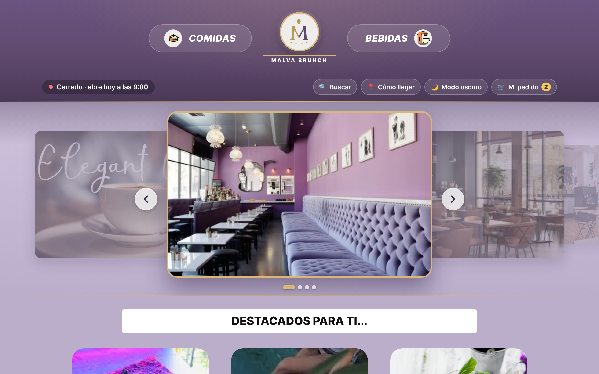
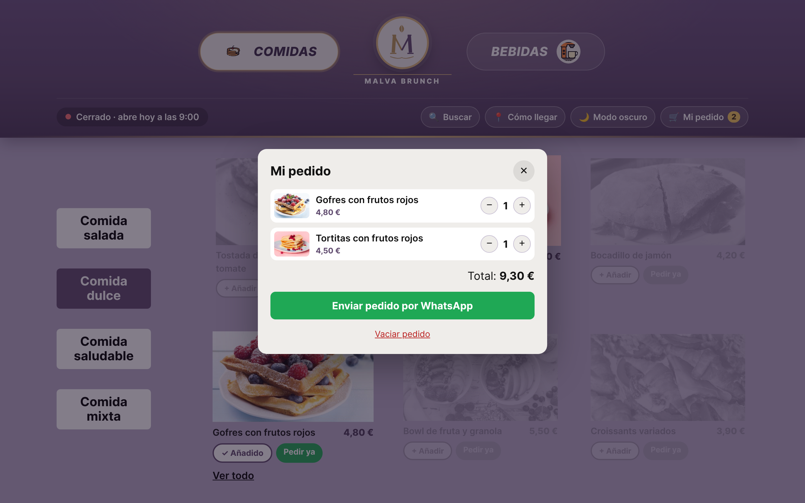
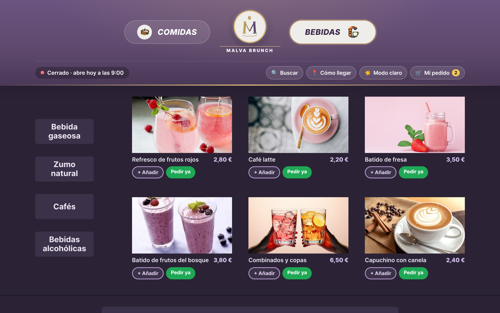
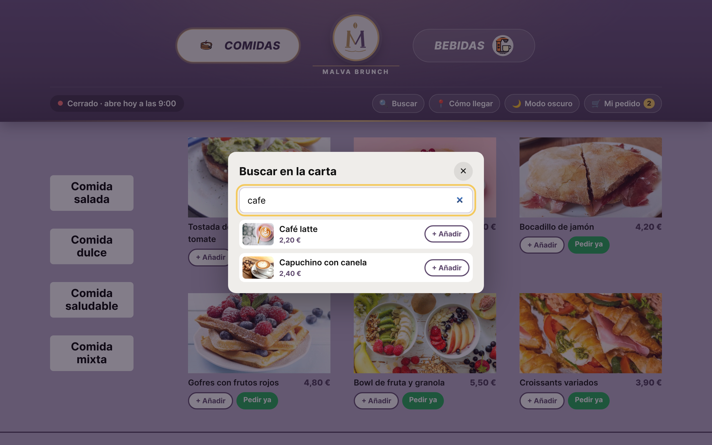
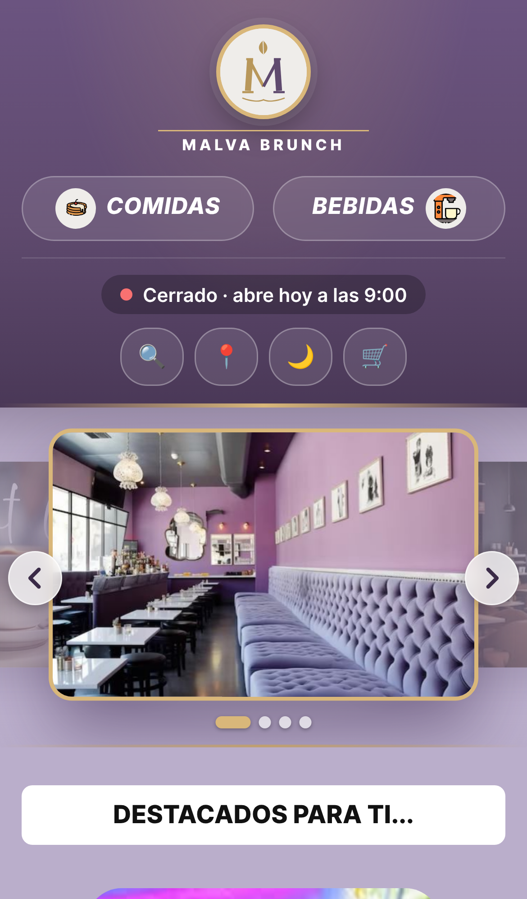

# Malva Brunch · Web de una cafetería de brunch


Web de **Malva Brunch**, una cafetería de brunch de Sevilla, con su carta de comidas y bebidas, un carrito de pedido que se envía por WhatsApp, buscador y modo oscuro. Hecha con **HTML, CSS y JavaScript, sin frameworks ni librerías**.

> 🎓 **Proyecto del ciclo de Desarrollo de Aplicaciones Web (DAW)**, hecho por mí. Primero **diseñé la web en Figma** y después la pasé a código.
>
> 💡 **Malva Brunch es un negocio ficticio**: el nombre, el logo, la dirección, el teléfono y el email son de ejemplo.

🔗 **Demo:** https://corderocana-dev.github.io/malva-brunch/



## ✨ Funcionalidades

- **Carrusel de fotos del local**: la foto central se ve grande y las laterales difuminadas. Funciona con flechas, puntos, deslizando con el dedo y con el teclado, y avanza solo (se pausa al pasar el ratón por encima).
- **Carrusel de destacados** en bucle infinito.
- **Carta de comidas y bebidas** con **filtros por categoría** (salada, dulce, saludable, mixta, cafés, zumos, refrescos y bebidas alcohólicas). Los enlaces llevan la categoría (`comidas.html#dulce`), así que se pueden compartir.
- **Fotos de la carta ampliables** en un visor.
- **Mi pedido**: un carrito que suma las cantidades y el total, se guarda en el navegador (aunque cierres la página) y se sincroniza entre pestañas.
- **Enviar el pedido por WhatsApp**: genera el mensaje con todos los productos y el total. Cada producto tiene además un botón **Pedir ya**.
- **Buscador** de productos que ignora tildes y mayúsculas.
- **Modo oscuro** que se recuerda y se aplica antes de pintar la página, sin parpadeo. Por defecto sigue el modo del sistema.
- **Abierto / cerrado ahora**: según el horario y la hora de España, aunque se visite desde otro país.
- **Formulario de sugerencias y quejas** que prepara el correo con el mensaje.
- **Diseño responsive**, adaptado a móvil.

## 📸 Capturas

| Mi pedido | Modo oscuro |
|---|---|
|  |  |

| Buscador | Móvil |
|---|---|
|  |  |

## ♿ Accesibilidad y SEO

- **Paneles con `<dialog>`** (buscador, pedido y visor de fotos): se cierran con Escape o haciendo clic fuera, y mantienen el foco dentro.
- **Etiquetas ARIA**, textos alternativos en todas las imágenes y navegación completa con teclado.
- Respeta la opción del sistema **"reducir movimiento"**: sin animaciones ni avance automático del carrusel.
- **SEO**: título y descripción en cada página, etiquetas **Open Graph** (vista previa al compartir el enlace) y **datos estructurados** de Google (`schema.org/CafeOrCoffeeShop`) con la dirección y el horario.

## 📁 Estructura

```
malva-brunch/
├── index.html      # Inicio: carrusel del local y destacados
├── comidas.html    # Carta de comidas
├── bebidas.html    # Carta de bebidas
├── info.html       # Conócenos, pedidos, sugerencias y textos legales
├── css/
│   ├── estilos.css       # Estilos generales, carruseles y carta
│   ├── cabecera-pie.css  # Cabecera y pie de página
│   └── tienda.css        # Buscador, pedido, modo oscuro y visor
├── js/
│   ├── main.js     # Carruseles, filtros de la carta, formulario y horario
│   └── tienda.js   # Pedido, buscador, modo oscuro y visor de fotos
├── img/            # Fotos e iconos
└── docs/           # Capturas del README
```

## 🚀 Cómo verla en local

No necesita instalar nada: es una web estática.

```bash
git clone https://github.com/corderocana-dev/malva-brunch.git
```

Abre `index.html` en el navegador. Si prefieres un servidor local, en VS Code puedes usar la extensión **Live Server**.

## 📷 Imágenes

Proyecto con **fines educativos**. Las fotografías se obtuvieron de internet para el ejercicio y **pertenecen a sus respectivos autores**; no se usan con fines comerciales. Si eres el autor de alguna y quieres que la retire, abre un *issue* y la quito.

## 👤 Autor

**Antonio Cordero Caña** · [GitHub](https://github.com/corderocana)
